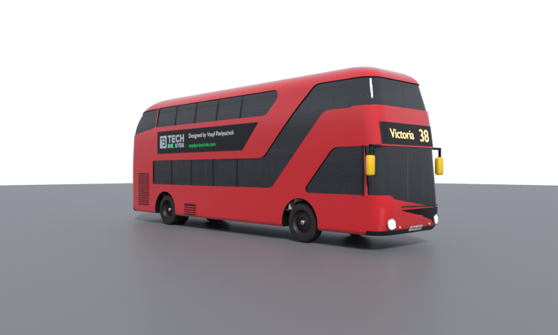

[🇪🇸 Español](README.md) | 🇬🇧 **English**

# 🚌 London Bus 3D

**A free, ready-to-use 3D model of a red London double-decker bus for Blender, Unity, Unreal, Godot, Three.js or anything else.** Real-world scale in metres, visible interior, and a light version for big scenes.

**See it in 3D:** [vasylpavlyuchok.com/ai/lab/london-bus-3d](https://vasylpavlyuchok.com/ai/lab/london-bus-3d)

## Downloads

| File | Use it for | Size |
|---|---|---|
| [`london-bus.glb`](https://github.com/vasyl-pavlyuchok/london-bus-3d/releases/latest/download/london-bus.glb) | Web (Three.js, Babylon), Blender, Godot. **Recommended** | 2.2 MB |
| [`london-bus_LOD1.glb`](https://github.com/vasyl-pavlyuchok/london-bus-3d/releases/latest/download/london-bus_LOD1.glb) | Light version for scenes with many buses | 50 KB |
| [`london-bus.fbx`](https://github.com/vasyl-pavlyuchok/london-bus-3d/releases/latest/download/london-bus.fbx) | Unity, Unreal, Maya, 3ds Max | 1.4 MB |
| [`london-bus-obj.zip`](https://github.com/vasyl-pavlyuchok/london-bus-3d/releases/latest/download/london-bus-obj.zip) | OBJ + materials (.mtl), for any 3D app | 0.9 MB |

## What's inside

- **Real scale**: 11.23 × 2.52 × 4.30 m. Metres, Y up, front facing +Z (glTF).
- **Detailed**: about 64,000 triangles. Body with thickness, recessed framed windows, dark reflective glass, seats, poles, both staircases and the driver's cab.
- **LOD1**: about 1,400 triangles with the same silhouette.
- **Materials named by what they do**: `BUS_pintura` (paint — recolour it), `BUS_vidrio` (glass), `BUS_faros` (headlights), `BUS_pilotos` (tail lights)…
- No third-party brands: "Victoria 38" destination, made-up number plate and our own ad.

## Why it exists

I made it to see how far Claude can go modelling a real object in Blender **from photos alone**, without opening Blender's interface: the whole model comes from a script. It took thirteen rounds of corrections until the side silhouette matched a real photo at 97%. The method is in [`metodo/`](metodo/METODO.md) (in Spanish) if you want to repeat it with another object.

## License

- **The 3D model** (`model/`, `previews/`, `viewer/`): [CC BY 4.0](LICENSE-MODEL). Use it anywhere, commercial projects included, with credit: "London Bus 3D by Vasyl Pavlyuchok (vasylpavlyuchok.com)".
- **The code** (`metodo/`): [MIT](LICENSE).

The New Routemaster was designed by Heatherwick Studio and Wrightbus. This is an independent model, not affiliated with Transport for London or any bus operator.

## Changelog

- **1.0.0** (7 Nov 2026): first release. GLB, LOD1, FBX and OBJ; web viewer. [Full changelog](README.md#changelog).

Made by **Vasyl Pavlyuchok & Claude**.
