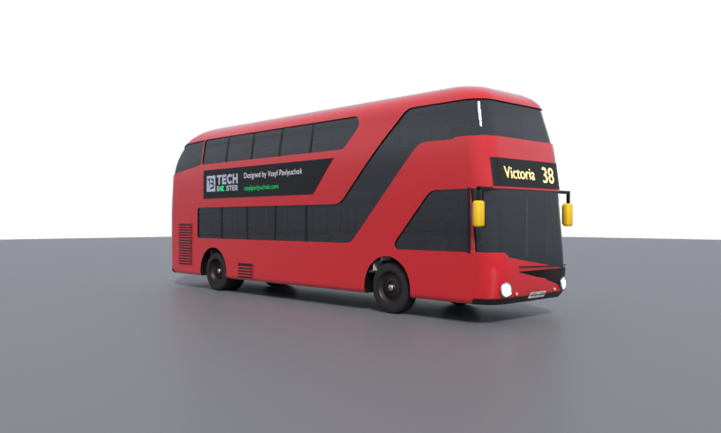

🇪🇸 **Español** | [🇬🇧 English](README.en.md)

# 🚌 London Bus 3D

**Un autobús rojo de dos pisos de Londres en 3D, gratis y listo para usar en Blender, Unity, Unreal, Godot, Three.js o donde quieras.** Escala real en metros, interior visible, versión ligera para escenas grandes.

**Verlo en 3D:** [vasylpavlyuchok.com/ai/lab/london-bus-3d](https://vasylpavlyuchok.com/ai/lab/london-bus-3d)

## Descargas

| Archivo | Para qué | Tamaño |
|---|---|---|
| [`london-bus.glb`](https://github.com/vasyl-pavlyuchok/london-bus-3d/releases/latest/download/london-bus.glb) | Web (Three.js, Babylon), Blender, Godot. **El recomendado** | 2,2 MB |
| [`london-bus_LOD1.glb`](https://github.com/vasyl-pavlyuchok/london-bus-3d/releases/latest/download/london-bus_LOD1.glb) | Versión ligera para escenas con muchos autobuses | 50 KB |
| [`london-bus.fbx`](https://github.com/vasyl-pavlyuchok/london-bus-3d/releases/latest/download/london-bus.fbx) | Unity, Unreal, Maya, 3ds Max | 1,4 MB |
| [`london-bus-obj.zip`](https://github.com/vasyl-pavlyuchok/london-bus-3d/releases/latest/download/london-bus-obj.zip) | OBJ + materiales (.mtl), para cualquier programa | 0,9 MB |

## Qué trae

- **Escala real**: 11,23 × 2,52 × 4,30 m. Unidades en metros, Y arriba, frontal hacia +Z (glTF).
- **Detallado**: unos 64.000 triángulos. Carrocería con grosor, ventanas hundidas con marco, cristal oscuro y reflectante, asientos, barras, las dos escaleras y el puesto del conductor.
- **LOD1**: unos 1.400 triángulos con la misma silueta.
- **Materiales con nombre que dice qué hacen**: `BUS_pintura` (cámbiale el color), `BUS_vidrio` (cristal), `BUS_faros`, `BUS_pilotos`…
- Sin marcas de terceros: rótulo «Victoria 38», matrícula inventada y un anuncio propio.

## ¿Por qué existe?

Lo hice para comprobar hasta dónde llega Claude modelando en Blender un objeto real **solo a partir de fotos**, sin abrir la interfaz de Blender: todo el modelo sale de un script. Costó trece rondas de correcciones hasta que la silueta lateral coincidió en un 97 % con una foto real. El método está en [`metodo/`](metodo/METODO.md), por si quieres repetirlo con otro objeto.

## Cómo se hizo

1. Fotos reales de referencia (lateral pura, frontal, trasera y tres cuartos).
2. Medidas sacadas de la foto lateral píxel a píxel, con el largo real como escala.
3. Carrocería por perfiles en Blender 4.5 sin ventana, con ventanas recortadas y esquinas redondeadas.
4. Cada ronda, render desde la cámara de cada foto y comparación foto | render, de lejos y de cerca.
5. Exportado a glTF, FBX y OBJ, con un visor web con panel de mando.

## Licencia

- **El modelo 3D** (`model/`, `previews/`, `viewer/`): [CC BY 4.0](LICENSE-MODEL). Úsalo donde quieras, también en proyectos comerciales, citando: «London Bus 3D por Vasyl Pavlyuchok (vasylpavlyuchok.com)».
- **El código** (`metodo/`): [MIT](LICENSE).

El New Routemaster es un diseño de Heatherwick Studio y Wrightbus. Este es un modelo independiente, sin relación con Transport for London ni con ningún operador.

## Changelog

- **1.0.0** (7-nov-2026): primera versión. GLB, LOD1, FBX y OBJ; visor web.

Hecho por **Vasyl Pavlyuchok & Claude**.
